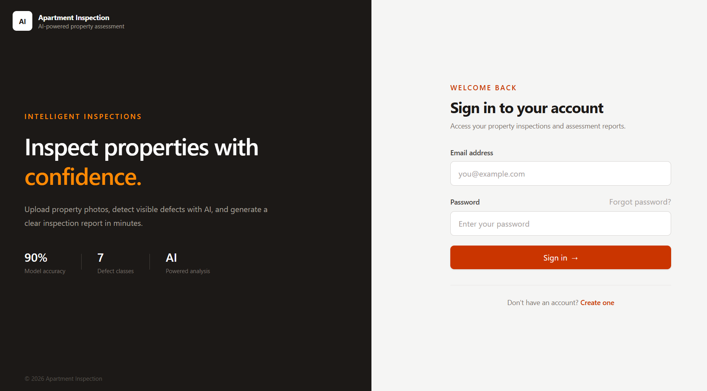
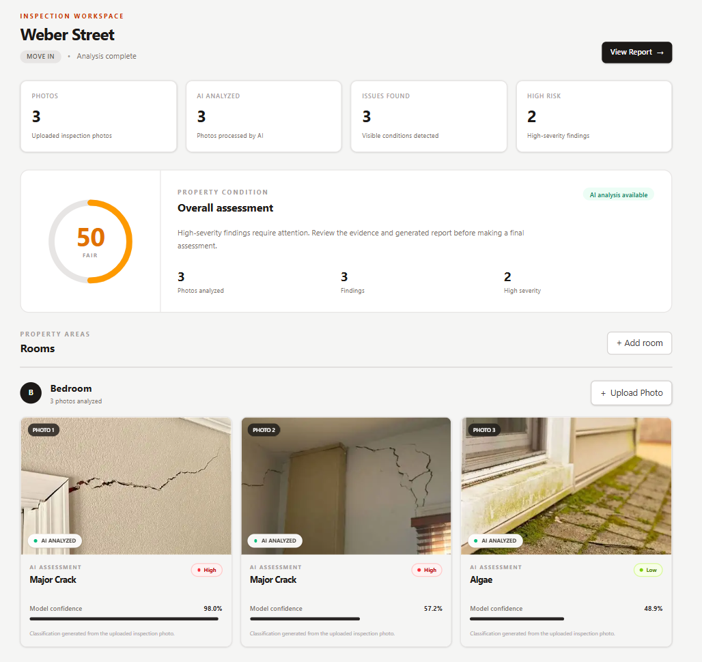
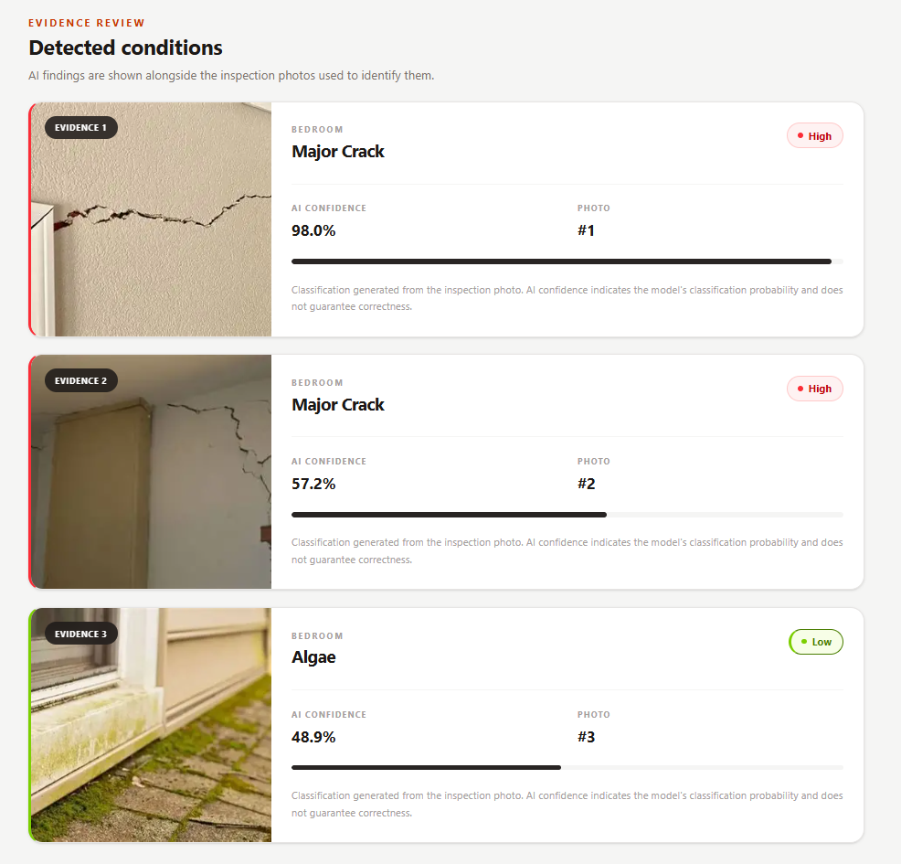
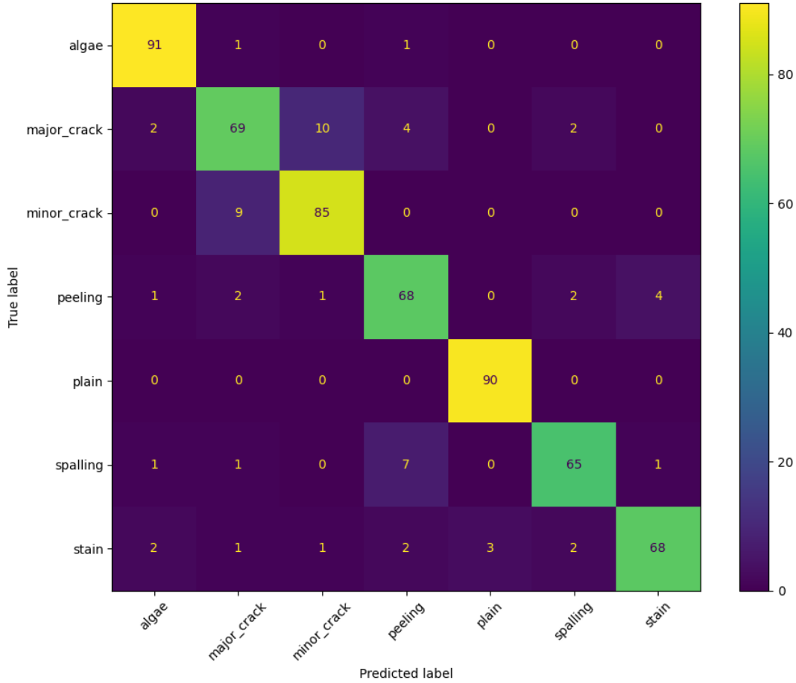

# Room Surface Defect Classifier

A full-stack web app that classifies wall and ceiling defects from photos of apartment rooms. Users upload photos, a ResNet18 model labels the defect and rates its severity, and the results are saved in per-room inspection reports.

## Features

- **Defect classification**: a fine-tuned ResNet18 sorts images into 7 classes and returns the top-3 predictions with confidence scores.
- **Severity rating**: each prediction maps to a severity of `None`, `Low`, `Medium` or `High`.
- **Inspection management**: users register, log in, add rooms, run inspections and view reports.
- **JWT authentication**: passwords are hashed with Argon2.
- **Dockerised**: Postgres, backend and frontend run together with Docker Compose.

## Screenshots

| Login | Inspection dashboard |
| --- | --- |
|  |  |

| Inspection report | Model confusion matrix |
| --- | --- |
|  |  |

The dashboard shows an overall property condition score and each room's photos. Each photo carries the predicted defect, its severity and the model's confidence. The report page lists every detected condition next to the photo it came from.

## Defect classes and severity

| Class         | Severity |
| ------------- | -------- |
| `plain`       | None     |
| `algae`       | Low      |
| `minor_crack` | Low      |
| `stain`       | Low      |
| `peeling`     | Medium   |
| `spalling`    | Medium   |
| `major_crack` | High     |

## Tech stack

| Layer    | Technology                                                      |
| -------- | --------------------------------------------------------------- |
| ML       | PyTorch, torchvision (ResNet18, 224×224 input)                  |
| Backend  | FastAPI, SQLAlchemy, Alembic, PostgreSQL, PyJWT                 |
| Frontend | React 19, TypeScript, Vite, Tailwind CSS 4, React Router, Axios |
| Infra    | Docker, Docker Compose                                          |

## Project structure

```
.
├── backend/            FastAPI app (routes, schemas, DB models, auth) + Alembic migrations
├── frontend/           React + Vite single-page app
├── ml/
│   ├── models/         Trained weights (room_surface_defect_resnet18.pth)
│   └── src/            Model loading and inference code
├── notebooks/          Training notebook (room-surface-defect-classifier.ipynb)
├── dataset/            Training images, one folder per class (not tracked in git)
├── uploads/            User-uploaded inspection images (not tracked in git)
├── alembic.ini
└── docker-compose.yml
```

## Getting started

### Option 1: Docker Compose

```bash
cp .env.example .env     # then set DATABASE_PASSWORD and SECRET_KEY
docker compose up --build
```

- Frontend: http://localhost:5173
- Backend API: http://localhost:8000 (interactive docs at `/docs`)

The backend container applies database migrations (`alembic upgrade head`) on startup.

### Option 2: Run locally

**Prerequisites:** Python 3.13, Node.js 22, a running PostgreSQL instance.

**Backend** (run from the repository root, because imports use the `backend.` and `ml.` packages):

```bash
python -m venv .venv
source .venv/bin/activate          # Windows: .venv\Scripts\activate
pip install -r backend/requirements.txt
pip install torch torchvision --index-url https://download.pytorch.org/whl/cpu

cp .env.example .env               # set DATABASE_* and SECRET_KEY; create the database first
alembic upgrade head
uvicorn backend.app.main:app --reload
```

**Frontend:**

```bash
cd frontend
cp .env.example .env               # optional locally; defaults to http://127.0.0.1:8000/api
npm install
npm run dev
```

## Configuration

Backend (`.env` in the repository root):

| Variable                                   | Purpose                                                             |
| ------------------------------------------ | ------------------------------------------------------------------- |
| `DATABASE_USER` / `_PASSWORD` / `_HOST` / `_PORT` / `_NAME` | Postgres connection parts                          |
| `DATABASE_URL`                             | Single connection URL for managed hosts. Takes precedence over the parts above |
| `SECRET_KEY`                               | JWT signing key. Required: the app won't start without it           |
| `FRONTEND_ORIGINS`                         | Comma-separated origins allowed by CORS                             |

Frontend (`frontend/.env`):

| Variable            | Purpose                                                   |
| ------------------- | --------------------------------------------------------- |
| `VITE_API_BASE_URL` | Backend base URL, including the `/api` suffix             |

## API overview

All routes are prefixed with `/api`. Everything except `/auth/*` requires an `Authorization: Bearer <token>` header. Uploads must be JPEG, PNG, WebP, BMP or GIF and at most 10 MB.

| Method | Endpoint                    | Description                          |
| ------ | --------------------------- | ------------------------------------ |
| POST   | `/auth/register`            | Create an account                    |
| POST   | `/auth/login`               | Log in and receive a JWT             |
| POST   | `/rooms`                    | Create a room in an inspection (`inspection_id`, `name`) |
| POST   | `/rooms/{room_id}/images`   | Upload an image for a room           |
| POST   | `/inspections`              | Create an inspection                 |
| GET    | `/inspections`              | List your inspections                |
| GET    | `/inspections/{id}`         | Get an inspection report             |
| POST   | `/predict`                  | Classify an uploaded image (requires a JWT) |

Example prediction response:

```json
{
  "filename": "wall.jpg",
  "prediction": "major_crack",
  "confidence": 0.94,
  "severity": "High",
  "top_predictions": [
    { "class": "major_crack", "confidence": 0.94 },
    { "class": "minor_crack", "confidence": 0.04 },
    { "class": "spalling", "confidence": 0.01 }
  ]
}
```

## Model

- **Architecture:** ResNet18 with the final layer replaced by a 7-way linear classifier.
- **Weights:** `ml/models/room_surface_defect_resnet18.pth`
- **Preprocessing:** resize to 224×224, then ImageNet mean/std normalisation.
- **Training:** see [notebooks/room-surface-defect-classifier.ipynb](notebooks/room-surface-defect-classifier.ipynb).

### Test-set results

The model scores **about 90% accuracy** on the held-out test set (536 of 596 images correct, read from the confusion matrix below).


- `plain` and `algae` are the easiest classes (90/90 and 91/93 correct).
- The most common mistakes are between visually similar classes: `major_crack` vs `minor_crack`, and `spalling` vs `peeling`. `major_crack` is the weakest class at 69 of 87 correct (about 79%).
- Because `major_crack` is the highest-severity class, a miss can hide a serious defect. Treat the output as a first-pass screening aid and not a substitute for a professional inspection.

To classify a single image from the command line (from the repository root):

```bash
python -m ml.src.run_inference path/to/image.jpg
```

Or send an image to `POST /api/predict` through the interactive docs at `/docs` (log in via `/api/auth/login` and use the Authorize button first).

### Dataset

3,965 images across 7 classes:

| Class         | Images |
| ------------- | ------ |
| `algae`       | 620    |
| `major_crack` | 580    |
| `minor_crack` | 624    |
| `peeling`     | 520    |
| `plain`       | 600    |
| `spalling`    | 500    |
| `stain`       | 521    |

The dataset isn't included in the repository. To retrain, put images in `dataset/<class_name>/`.
